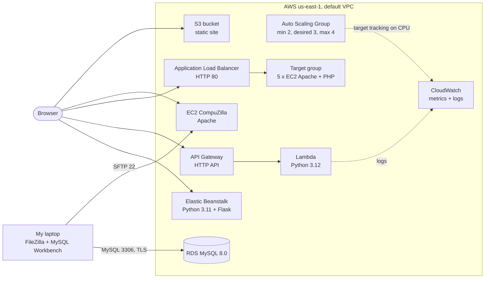
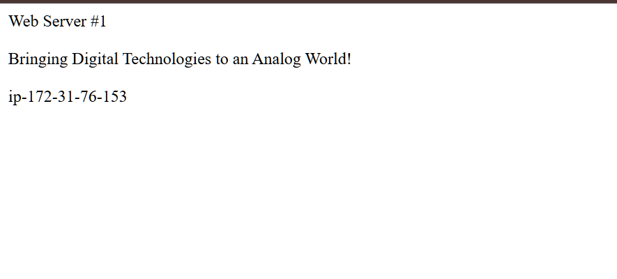
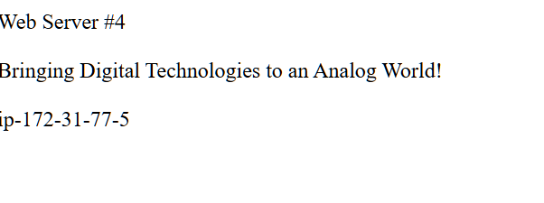
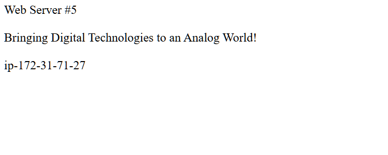
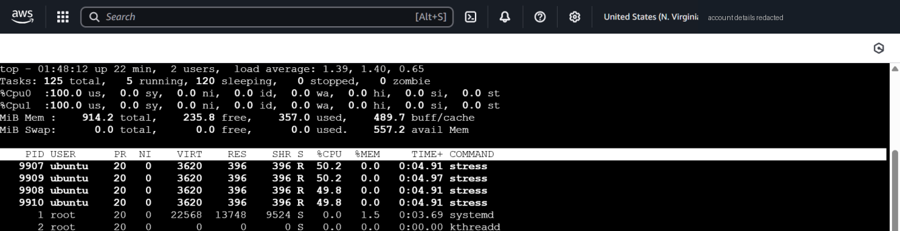

# CompuTech on AWS — Hands-on Cloud Infrastructure

Deploying the same small business website **seven different ways on AWS**: S3, EC2, Auto Scaling, an Application Load Balancer, RDS, Lambda and Elastic Beanstalk. Each part is documented with what I built, what broke, and what I'd change for production.

> **Context:** built in the AWS Academy Learner Lab for the *Cloud Computing Fundamentals* module of my BSc in Computing & IT at CCT College Dublin (December 2025). "CompuTech" is a fictional custom-audio-equipment company from the project brief. All resources have since been deleted; account details in screenshots are redacted.

## Architecture



## What's in this project

| # | Part | AWS services | What it shows | Write-up |
|---|---|---|---|---|
| 1 | Static website | S3 | Bucket policies vs. Block Public Access, encryption, versioning | [docs](docs/01-s3-static-website.md) |
| 2 | Auto scaling | EC2, Launch Templates, Auto Scaling, CloudWatch | Launch templates, user data, target-tracking policy, load test with `stress` | [docs](docs/02-auto-scaling-group.md) |
| 3 | Manual web server | EC2, Apache, SFTP | Linux server setup, file ownership/permissions | [docs](docs/03-ec2-web-server-sftp.md) |
| 4 | Load balancing | ALB, Target Groups, EC2 | Traffic spread across 5 servers via one DNS name | [docs](docs/04-application-load-balancer.md) |
| 5 | Managed database | RDS for MySQL | Network access with security groups, remote admin over TLS | [docs](docs/05-rds-mysql.md) |
| 6 | Serverless | Lambda, API Gateway | Event-driven function, execution roles, debugging event shape | [docs](docs/06-lambda-api-gateway.md) |
| 7 | PaaS | Elastic Beanstalk | Deploying a Flask app from a ZIP, fixing a 502 | [docs](docs/07-elastic-beanstalk.md) |
| ★ | **Security review** | all | My own build reviewed against production best practice | [docs](docs/security-review.md) |

## Highlights

**Load balancer spreading requests across servers**

| | | |
|---|---|---|
|  |  |  |

**Auto Scaling Group under a CPU stress test**



**Static site served from S3**


## Problems I debugged

- **S3 still "Access Denied" after turning off Block Public Access.** Block Public Access only *permits* public access; a bucket policy has to *grant* it.
- **FileZilla "permission denied" on `/var/www/html`.** The folder is owned by root and SFTP runs as `ubuntu`. Fixed with ownership + least-privilege permissions, not `777` ([script](ec2/deploy-permissions.sh)).
- **Lambda: `iam:CreateRole` denied.** The lab blocks role creation; used the pre-made `LabRole`.
- **Lambda returned "No number provided" through API Gateway.** The function read `event["number"]`, but API Gateway puts it in `queryStringParameters`. Fixed and unit-tested ([code](lambda/lambda_function.py)).
- **Elastic Beanstalk 502 Bad Gateway** and a security-group creation failure in a custom VPC.

## What I'd improve next
Written up in detail in the [security review](docs/security-review.md). In short:
- CloudFront + Origin Access Control in front of a private S3 bucket
- Attach the Auto Scaling Group to the ALB target group, spread across ≥ 2 AZs, instances in private subnets
- HTTPS with ACM; SSM Session Manager instead of open SSH
- RDS in private subnets, Multi-AZ, credentials in Secrets Manager
- Rebuild the whole thing as **Infrastructure as Code** (Terraform or CloudFormation) so it can be deployed and torn down with one command

## Repository layout

```
.
├── docs/                    # Write-up per part + screenshots
├── website/                 # CompuTech static site (S3 + EC2 parts)
├── s3/bucket-policy.json    # Public-read policy used in Part 1
├── ec2/
│   ├── user-data-web-server.sh   # Bootstrap: Apache + PHP + hostname page
│   └── deploy-permissions.sh     # Least-privilege web-root permissions
├── lambda/                  # Fixed handler, test event, unit tests
└── elastic-beanstalk/       # Flask app + requirements for the EB bundle
```

## Running the bits you can run locally

```bash
# Lambda unit tests
cd lambda && python -m unittest -v

# Elastic Beanstalk app
cd elastic-beanstalk && pip install -r requirements.txt && python application.py
```

## Cleaning up (if you rebuild this)
Delete in this order to avoid dependency errors and surprise charges: Elastic Beanstalk environment → Lambda function + API → load balancer → target group → Auto Scaling Group → remaining EC2 instances → RDS instance → empty and delete the S3 bucket → unused security groups and key pairs.

## Author
**Shahzaib Hassan**, BSc Computing & IT student, CCT College Dublin. Working towards cloud security engineering.
