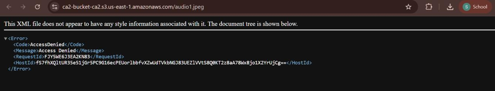
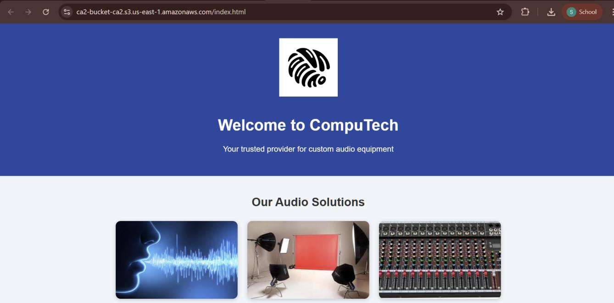

# Part 1 — Static website on Amazon S3

**Goal:** host the one-page CompuTech site (HTML, CSS, 4 images) from an S3 bucket.

## What I configured
| Setting | Value |
|---|---|
| Region | us-east-1 |
| Bucket type | General purpose |
| Object ownership | ACLs disabled (bucket owner enforced) |
| Versioning | Enabled |
| Default encryption | SSE-S3, Bucket Key enabled |
| Objects | `index.html`, `style.css`, `logo.png`, `audio1.jpeg`, `studio.jpeg`, `mixer.jpeg` |

## What happened
1. Created the bucket with **Block Public Access on** (the default) and uploaded the files.
2. Opened an object URL in the browser → **AccessDenied**. Expected: nothing is public yet.

   

3. Turned Block Public Access **off** → still **AccessDenied**.
   This was the useful lesson: Block Public Access only *allows* public access to be granted. Something still has to grant it.
4. Added a bucket policy allowing `s3:GetObject` to everyone ([`s3/bucket-policy.json`](../s3/bucket-policy.json)) → objects and the site loaded.

   

## Takeaways
- Public S3 access needs two things: Block Public Access relaxed **and** a policy (or ACL) that grants read.
- The policy `Resource` must match the bucket name exactly (`arn:aws:s3:::bucket-name/*`). A typo there means the policy grants nothing.
- I served the site through the object URL (`https://<bucket>.s3.us-east-1.amazonaws.com/index.html`), not the S3 static website endpoint. For a real site I'd put **CloudFront with Origin Access Control** in front and keep the bucket private (see the [security review](security-review.md)).
