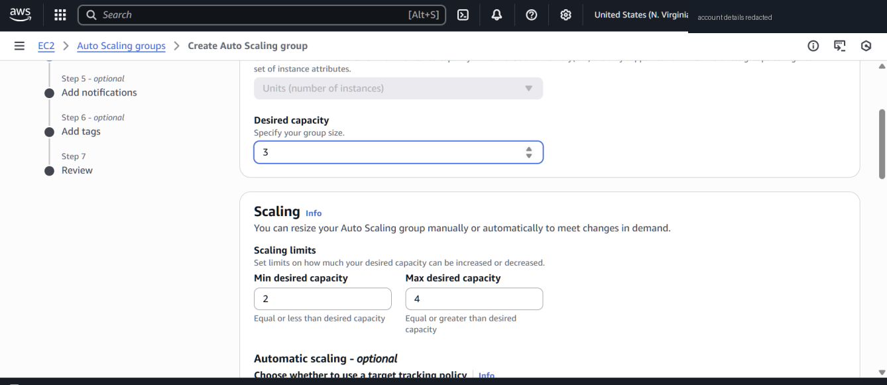
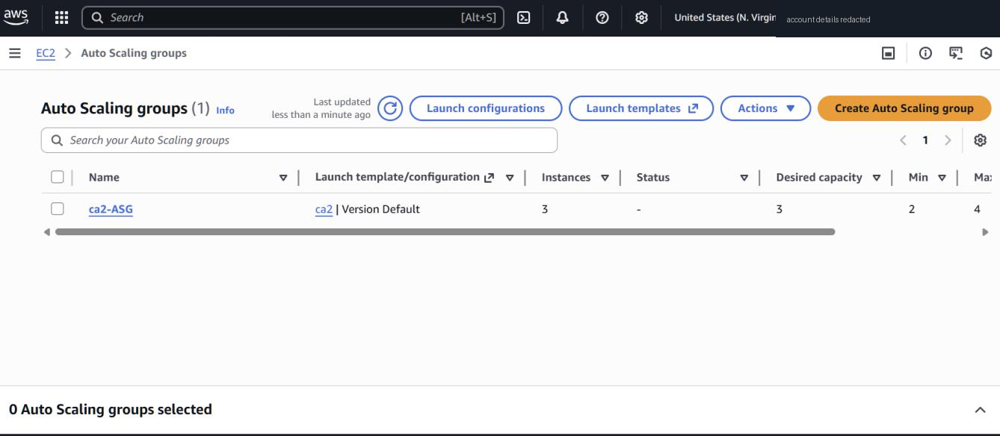
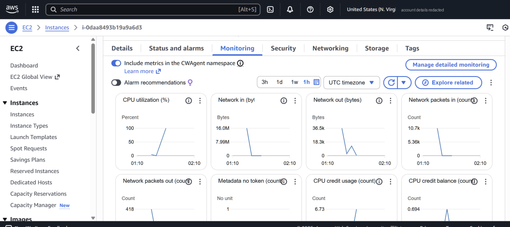
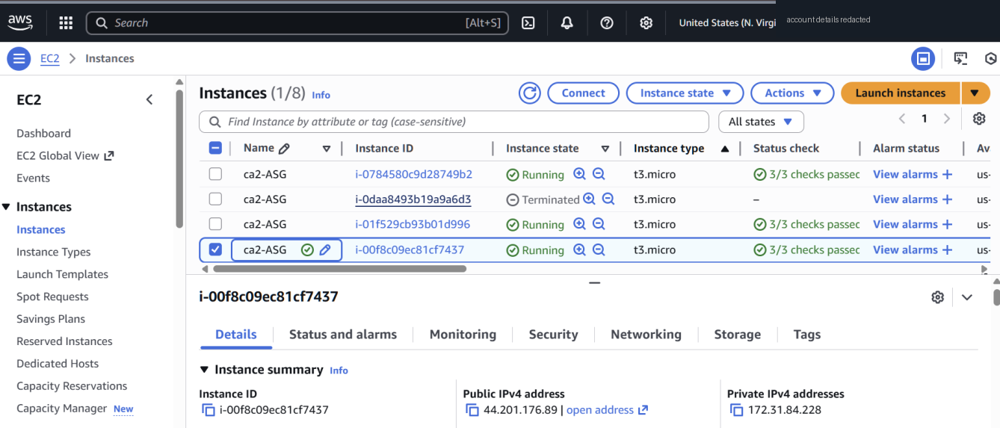

# Part 2 — EC2 Auto Scaling Group

**Goal:** a fleet of Ubuntu web servers that keeps a minimum capacity and reacts to CPU load.

## Launch template
| Setting | Value |
|---|---|
| AMI | Ubuntu Server 24.04 LTS (x86_64) |
| Instance type | t3.micro |
| Security group | SSH 22 + HTTP 80 inbound |
| User data | [`ec2/user-data-web-server.sh`](../ec2/user-data-web-server.sh) — installs Apache + PHP, page prints the hostname |

## Auto Scaling Group
| Setting | Value |
|---|---|
| VPC / subnets | Default VPC, us-east-1a + us-east-1b |
| Capacity | min **2** · desired **3** · max **4** |
| Scaling policy | Target tracking, **average CPU 50%** |
| Health checks | EC2 (always) + EBS health checks |
| Load balancer | None (added separately in Part 4) |




## Load test
SSH'd into one instance, installed `stress` and ran:

```bash
sudo apt update && sudo apt install -y stress
stress --cpu 4 --timeout 300
```

CPU on that instance hit 100%:




The group then terminated the stressed instance and launched a new one, keeping 3 running:



## Honest review of the test
Looking back, this test didn't cleanly prove **scale-out**:

- Target tracking uses the **group average**. One instance at 100% and two idle ones is roughly (100 + ~0 + ~0) / 3 ≈ 33%, which is *below* the 50% target. So the policy may never have fired.
- I didn't screenshot the ASG **Activity** tab, so I can't show *why* the instance was replaced (scaling action vs. health check).

**How I'd rerun it:** stress *every* instance (or drop the target to ~20%), then capture the Activity history and the CloudWatch alarm going into `ALARM` as proof of scale-out to 4, and the scale-in afterwards.
