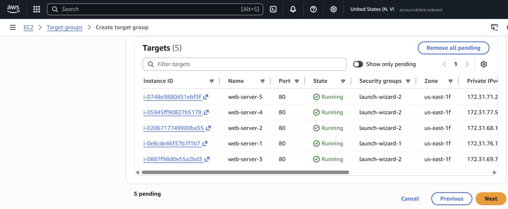
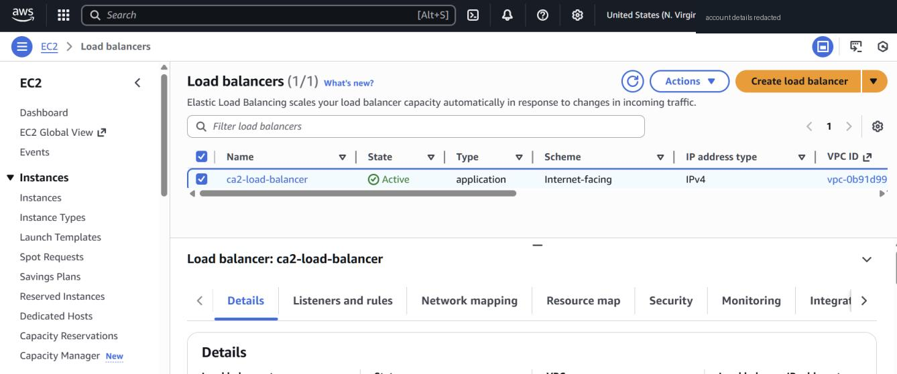

# Part 4 — Application Load Balancer across 5 web servers

**Goal:** put five web servers behind one DNS name and show requests being spread across them.

## Build
1. Launched **5 Ubuntu t3.micro instances** (`web-server-1` … `web-server-5`) using [`ec2/user-data-web-server.sh`](../ec2/user-data-web-server.sh), changing the label per server so each page says which one answered.
2. Created target group **`ca2-target-group`**: instances, HTTP:80, HTTP1, default VPC; registered all 5.

   

3. Created **internet-facing ALB** `ca2-load-balancer` (IPv4) with subnets in multiple AZs and a listener **HTTP:80 → forward to `ca2-target-group`**.

   

## Result
Refreshing the ALB DNS name returned different servers each time:

| | | |
|---|---|---|
|  |  |  |

## Honest review
- **All 5 targets were in the same AZ (us-east-1f)** (visible in the target group screenshot). The ALB itself spans several AZs, but if us-east-1f went down every backend would go with it. Fix: launch targets across at least two AZs, ideally via an Auto Scaling Group attached to the target group (combining Parts 2 and 4).
- **HTTP only.** A production setup would add an HTTPS:443 listener with an ACM certificate and redirect 80 → 443.
- **Instances still had public IPs and open SSH.** Better: instance security group allows port 80 **only from the ALB's security group**, no public IPs, and Session Manager instead of SSH.
- ALB = Layer 7 (can route on path / host header). An NLB is Layer 4 (TCP/UDP, static IPs, very high throughput). The brief mentioned NLB; an ALB was the right fit for plain HTTP websites.
