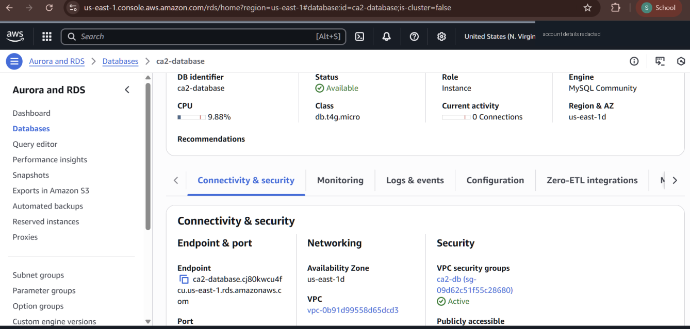
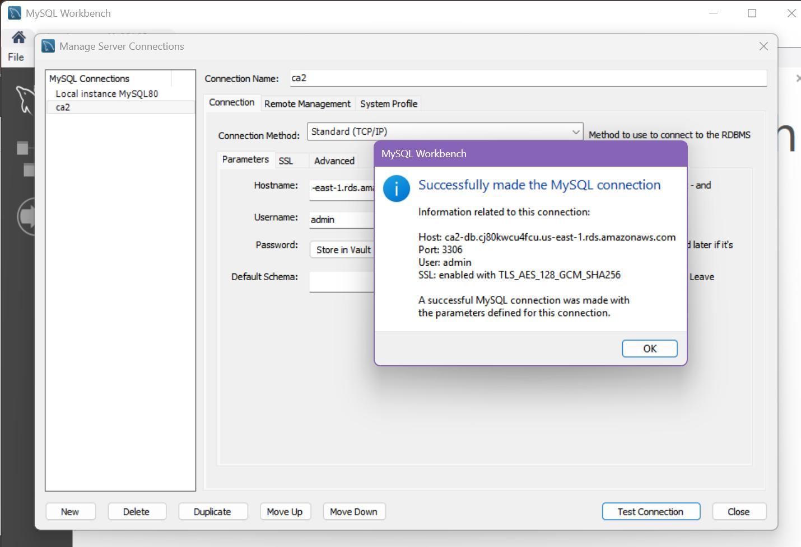

# Part 5 — Amazon RDS for MySQL + MySQL Workbench

**Goal:** run a managed MySQL database in AWS and work with it from a local machine.

## RDS configuration
| Setting | Value |
|---|---|
| Engine | MySQL Community 8.0.43 |
| Template | Sandbox |
| Deployment | Single-AZ DB instance |
| Class | db.t4g.micro |
| Storage | 20 GiB gp2 |
| Network | Default VPC, **publicly accessible: yes** |
| Security group | new `ca2-db`, inbound 3306 |
| Initial DB | `ca2_db` |
| Backups | Automated backups enabled |

## Connecting and importing
1. In MySQL Workbench: new connection → RDS endpoint, port 3306, user `admin`. **Test Connection** succeeded, over TLS (`TLS_AES_128_GCM_SHA256`).

   

2. Imported an existing SQL dump (a car-rental schema from my databases module) with *Server → Data Import*. The `Rental_CAR` schema was created, but the import finished with **1 error**: `ERROR 1146: Table 'Rental_CAR.customers' doesn't exist`. That usually means a statement in the dump references a table before it's created, or the table name's case differs. Next step would be to fix the statement order in the dump and re-run.

## Honest review
- **Public access + 3306 open** was needed to connect from a laptop in the lab. In production the DB goes in **private subnets**, its security group only allows 3306 **from the app servers' security group**, and admins connect through a bastion / Session Manager port forwarding.
- Single-AZ means no automatic failover. **Multi-AZ** for anything real.
- Credentials: use **AWS Secrets Manager** (with rotation) instead of a self-managed master password.
