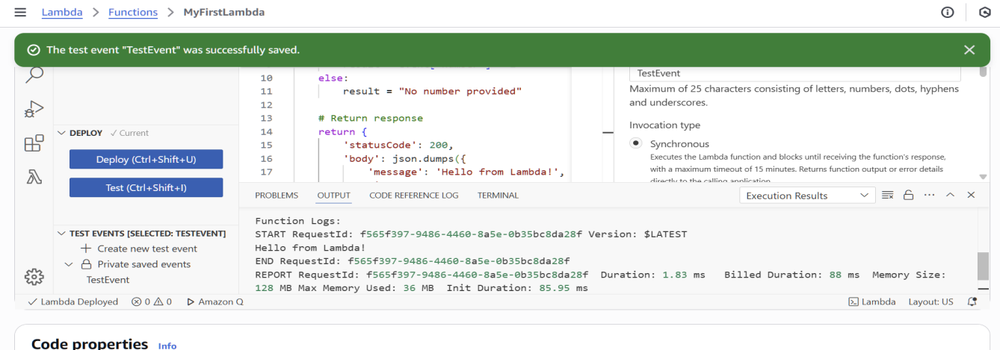
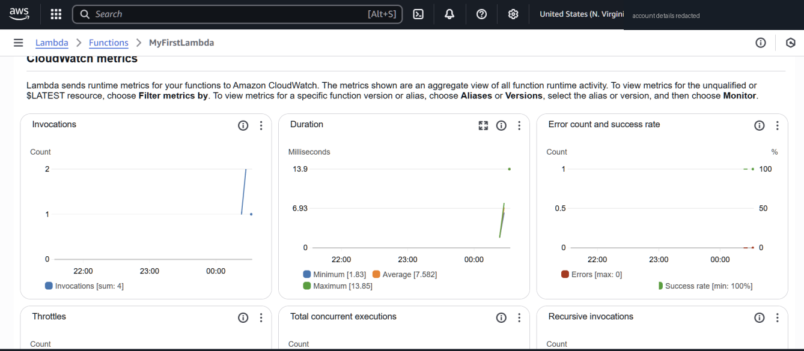

# Challenge 1 — AWS Lambda + API Gateway

**Goal:** a serverless function that doubles a number, callable from a browser.

## Steps
1. Created `MyFirstLambda` (Python 3.12, x86_64, author from scratch).
2. **"Create a new role with basic Lambda permissions" failed:** `Access denied to iam:CreateRole`. AWS Academy labs block creating IAM roles, so I picked the existing **`LabRole`** as the execution role.
3. Wrote the handler and tested it with a console event `{"number": 5}`.

   

4. Added an **API Gateway HTTP API** trigger and called the endpoint from the browser with `?number=20`.
5. Checked invocations, duration and errors in **CloudWatch**.

   

## Bug found while writing this up
The browser call returned `"doubled_number": "No number provided"` even though `?number=20` was in the URL.

Why: the function read `event["number"]`. That exists for a console test event, but through API Gateway the value arrives at `event["queryStringParameters"]["number"]`, **as a string**.

The fixed version in [`lambda/lambda_function.py`](../lambda/lambda_function.py) checks both places, converts the string to a number, returns `400` for missing or invalid input, and has unit tests:

```bash
cd lambda && python -m unittest -v
```

## Takeaways
- The event shape depends on the trigger. Always log or print the raw event once when wiring a new trigger.
- Execution roles are how Lambda gets permissions; least privilege means the role allows only what the function needs (here: writing CloudWatch logs).
