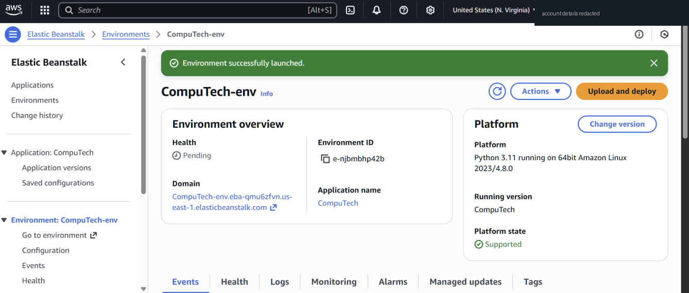
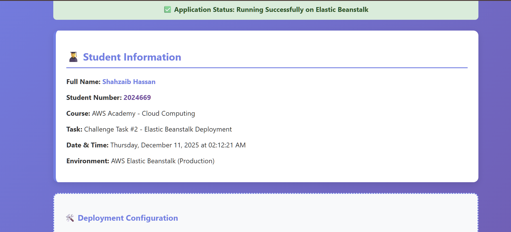

# Challenge 2 — AWS Elastic Beanstalk (PaaS)

**Goal:** deploy a small web app without building the servers by hand.

## Configuration
| Setting | Value |
|---|---|
| Tier | Web server environment |
| Platform | Python 3.11 on 64-bit Amazon Linux 2023 |
| Code | ZIP upload of a small Flask app ([`elastic-beanstalk/`](../elastic-beanstalk)) |
| Service role | `LabRole` (lab can't create new roles) |
| EC2 instance profile | an existing role available in the lab |
| Health reporting | Enhanced |

## Problems I hit
| Problem | Fix |
|---|---|
| Security group creation failed in the selected VPC | Left VPC settings on defaults instead of picking a custom VPC |
| **502 Bad Gateway** | Nginx couldn't get a response from the app. Fixed the Flask app so it correctly served the static page, checked the port settings, and redeployed |
| Missing dependencies | Listed Flask in `requirements.txt` so Beanstalk installs it on deploy |

## Takeaways
- Beanstalk still creates real EC2, security groups and (optionally) a load balancer for you. It's convenience, not magic, and you can see all of it in the console.
- On the Python platform the app needs a WSGI callable called `application` in `application.py` (or a `Procfile` to change that).
- Logs (*Environment → Logs*) and the Events tab were the fastest way to find the 502 cause.
